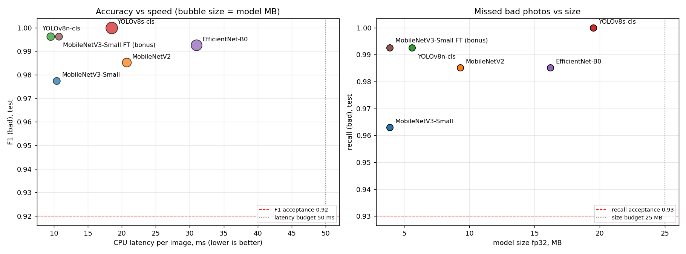
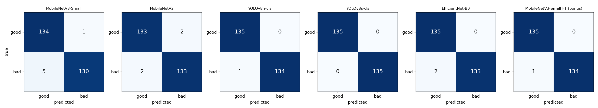

# Practice 6 — Model Selection and Evaluation for the Document Photo Quality Gate

**Author:** Vladislav Zherikhov · **Seed (student ID):** `24500003` · **Hardware:** MSI GL75 Leopard (i7-10750H CPU, GTX 1650 Ti, 16 GB RAM); all training and latency measurements on CPU

## Summary

A Telegram bot reads Russian documents (passport, INN, SNILS) from phone photos. Its **first gate** is a binary classifier: is the photo **good** (readable) or **bad** (blur, glare, skew, occlusion, bad exposure)? Bad photos get an instant "please retake" reply instead of a failed OCR attempt.

Across four tasks, **six models** were trained and compared under one protocol on the same split.

> **Decision: YOLOv8n-cls**: test accuracy 0.996, recall(bad) 0.993, 0 false alarms, **9.5 ms** per image on CPU, 5.6 MB.
> **Fallback:** MobileNetV3-Small fine-tuned, with identical quality, 3.9 MB and a BSD licence.

| Task | Content | Folder | Main document |
|---|---|---|---|
| 1 | Model selection memo: architectures, transfer learning, acceptance criteria fixed in advance | [`task1/`](task1/) | [`MODEL_SELECTION_MEMO.md`](task1/MODEL_SELECTION_MEMO.md) |
| 2 | Baseline: MobileNetV3-Small (main) + MobileNetV2 (course reference), frozen backbone | [`task2/`](task2/) | [`README.md`](task2/README.md) |
| 3 | YOLOv8 classification: nano and small, full fine-tuning, comparison with the baseline | [`task3/`](task3/) | [`README.md`](task3/README.md) |
| 4 | Third model (EfficientNet-B0), fine-tuning bonus, full comparison, error analysis, decision, presentation | [`task4/`](task4/) | [`README.md`](task4/README.md), [`DECISION_MEMO.md`](task4/DECISION_MEMO.md), [`PRESENTATION.md`](task4/PRESENTATION.md) |
| Group | Cross-testing: a classmate's YOLOv8n-cls evaluated on my dataset; my model packaged for the classmate | [`group_task/`](group_task/), [`release/`](release/) | [`README.md`](group_task/README.md) |

## Data and protocol (shared by all tasks)

| Item | Value |
|---|---|
| Dataset | `5_practice/data/quality_dataset`: 1800 synthetic images (INN, SNILS, passport), 900 good / 900 bad, 640×640, all watermarked "SYNTHETIC TRAINING SAMPLE" |
| Split | **70 / 15 / 15** by source document, stratified by document class: 1260 / 270 / 270, no source in two splits ([`common/split_70_15_15.jsonl`](common/split_70_15_15.jsonl)) |
| Positive class | **bad**: a missed bad photo (FN) is the most expensive error |
| Input | RGB, 224×224; ImageNet mean/std for torchvision models, native Ultralytics preprocessing for YOLO |
| Shortcut fix | in the dataset only GOOD images are rotated, so training uses random 0/90/180/270° rotations of **both** classes |
| No flips | horizontal/vertical flips disabled everywhere (mirrored text is unrealistic) |
| Leakage control | validation only for early stopping / best epoch; threshold fixed at 0.5; test evaluated once |
| Metrics | accuracy, precision, recall, F1 (bad), confusion matrix, recall per defect type: [`common/quality_common.py`](common/quality_common.py) |
| Latency protocol | CPU, batch 1, 224×224, fp32, 10 warm-up runs, then the mean of 100 runs, plus model size (fp32 state_dict) |
| Experiment log | [`experiment_log.csv`](experiment_log.csv): one row per trained model with seed, hyperparameters, time and metrics |

## Results (test split, 270 images)

| Model | Task | Regime | Accuracy | Precision (bad) | Recall (bad) | F1 (bad) | FN / FP | CPU latency* | Size | Params | Train time |
|---|---|---|---|---|---|---|---|---|---|---|---|
| MobileNetV3-Small | 2 | frozen | 0.978 | 0.992 | 0.963 | 0.977 | 5 / 1 | 10.4 ms | 3.9 MB | 1.00 M | 3.4 min |
| MobileNetV2 | 2 | frozen | 0.985 | 0.985 | 0.985 | 0.985 | 2 / 2 | 20.7 ms | 9.3 MB | 2.39 M | 16.4 min |
| YOLOv8n-cls | 3 | full fine-tune | **0.996** | 1.000 | 0.993 | **0.996** | **1 / 0** | **9.5 ms** | 5.6 MB | 1.44 M | 5.8 min |
| YOLOv8s-cls | 3 | full fine-tune | **1.000** | 1.000 | **1.000** | **1.000** | **0 / 0** | 18.5 ms | 19.5 MB | 5.08 M | 17.2 min |
| EfficientNet-B0 | 4 | frozen | 0.993 | 1.000 | 0.985 | 0.993 | 2 / 0 | 31.0 ms | 16.2 MB | 4.17 M | 10.4 min |
| MobileNetV3-Small FT | 4 (bonus) | frozen → last 3 blocks, lr 1e-4 | **0.996** | 1.000 | 0.993 | **0.996** | **1 / 0** | 10.7 ms | **3.9 MB** | 1.00 M | 5.9 min |

\* Re-measured for all models in one session (Task 4). Run-to-run variation is about ±1 ms.

**All six models pass all acceptance criteria** fixed in the Task 1 memo before the experiments: accuracy and F1 ≥ 0.92, recall(bad) ≥ 0.93, precision(bad) ≥ 0.88, recall ≥ 0.85 for every defect, latency ≤ 50 ms, size ≤ 25 MB.





## Key findings

1. **Training regime matters more than architecture.** Frozen ImageNet backbones (Task 2) miss partial defects: MobileNetV3-Small missed 5 bad photos, mostly occlusion and exposure. Fine-tuning fixes this. MobileNetV3-Small with its last 3 blocks fine-tuned at a 10× lower learning rate went from 0.978 to **0.996** accuracy (FN 5 → 1, FP 1 → 0), exactly matching the fully fine-tuned YOLOv8n-cls.
2. **FLOPs do not predict CPU latency.** YOLOv8n-cls has more FLOPs than MobileNetV3-Small but the same speed: dense convolutions use CPU vector units efficiently. EfficientNet-B0 is the slowest (31 ms, ±7 ms) because squeeze-and-excitation blocks and SiLU activations are expensive on CPU.
3. **Hardest defect in this dataset: occlusion** (mean recall 0.967), then exposure (0.976) and glare (0.988). Glare is easy here except on the white INN form, where white-on-white glare almost disappears. Several "errors" are label noise, for example an occlusion block over an empty corner of the page.
4. **The test set is small.** One image = 0.37 %, so the top three models (YOLOv8s, YOLOv8n, MobileNetV3-Small FT; 0–1 errors) are statistically equivalent in quality. The decision is therefore driven by cost and deployment factors.

## Decision

Following the decision rule fixed in the Task 1 memo:
1. All models pass the acceptance criteria.
2. The fastest group, within 5 ms of the fastest model, is YOLOv8n-cls (9.5 ms), MobileNetV3-Small (10.4 ms) and MobileNetV3-Small FT (10.7 ms).
3. The highest recall(bad) in that group is a tie between YOLOv8n-cls and MobileNetV3-Small FT (0.993).
4. The tie is broken by deployment simplicity, in favour of **YOLOv8n-cls**: one-stage training, one-command ONNX/OpenVINO export, and the same toolchain as a future YOLO field detector.
5. Main risks:
   - synthetic-to-real gap → validate on real photos before launch;
   - small test set;
   - AGPL-3.0 licence of Ultralytics → MobileNetV3-Small FT (BSD) is the fallback at equal quality.

Full reasoning: [`task4/DECISION_MEMO.md`](task4/DECISION_MEMO.md).

## Group task: a classmate's model on my dataset

I exchanged models with a classmate. My YOLOv8n-cls is packaged in [`release/yolov8n_quality_gate/`](release/yolov8n_quality_gate/) (weights, `predict.py`, instructions). Their YOLOv8n-cls (unchanged, in [`group_task/yolov8n_quality_gate/`](group_task/yolov8n_quality_gate/)) was run with their own script on all **1800** images of my dataset. Their model never saw these images.

| Evaluation | Model | Accuracy | F1 (bad) | Recall (bad) | FN / FP | CPU latency |
|---|---|---|---|---|---|---|
| my full dataset (1800) | classmate's YOLOv8n-cls | 0.956 | 0.956 | 0.958 | 38 / 41 | 9.6 ms |
| my test split (270) | classmate's YOLOv8n-cls | 0.963 | 0.963 | 0.963 | 5 / 5 | 9.6 ms |
| my test split (270) | my YOLOv8n-cls | **0.996** | **0.996** | **0.993** | **1 / 0** | 9.5 ms |

- Cross-dataset drop: **−3.7 pp** (0.993 on their own validation data → 0.956 on mine). The model passes 6 of 7 acceptance criteria and fails only Q5, because glare recall is 0.806.
- **Two systematic error groups explain 69 of 79 errors:**
  - faint white glare on the white INN form is missed (28 / 60);
  - SNILS cards tilted by more than ~6° are flagged as bad (41 / 84; all 27 above 6.5°), because the classmate trained without rotation augmentation and treats this tilt as skew, while in my labels ±3–8° is good.
- A different threshold does not help: the errors come from **different good/bad definitions** in the two datasets, not from calibration.

Details, charts and recommendations: [`group_task/README.md`](group_task/README.md).

## Evaluation guide checklist

| Requirement (Evaluation Guide 06) | Where |
|---|---|
| ≥ 3 architectures compared, ≥ 3 credible sources, transfer learning regimes, acceptance criteria in advance | [`task1/MODEL_SELECTION_MEMO.md`](task1/MODEL_SELECTION_MEMO.md) (7 model variants in the comparison table, 8 sources, numeric criteria) |
| RGB, normalisation, 224×224, binary output, 70/15/15 split | [`common/quality_common.py`](common/quality_common.py), all notebooks |
| Pretrained frozen backbone + GAP → dense → dropout → sigmoid | [`task2/`](task2/), [`common/torch_models.py`](common/torch_models.py) |
| Loss/accuracy curves saved and interpreted | `task2/outputs/*_curves.png`, `task3/outputs/yolo_curves.png`, `task4/outputs/*_curves.png` + README sections |
| Test-only evaluation with accuracy, precision, recall, F1, confusion matrix | every task's `outputs/test_metrics.json` and confusion matrix PNGs |
| Seed fixed, hyperparameters documented | seed 24500003 everywhere; hyperparameters in each notebook, `test_metrics.json` and `experiment_log.csv` |
| YOLO dataset structure from the same split, two variants, latency with warm-up, size, comparison with the baseline | [`task3/`](task3/) |
| Third model, full comparison table (accuracy, precision, recall, F1, latency, size, params, training time), charts, failure gallery, hardest defect, decision memo | [`task4/`](task4/) |
| 5-minute presentation | [`task4/PRESENTATION.md`](task4/PRESENTATION.md) (slide plan, speaker notes, Q&A) |
| Bonus: fine-tuning with a lowered learning rate and reported delta | [`task4/README.md`](task4/README.md#5-bonus-fine-tuning-with-a-lowered-learning-rate) |
| Group task: exchange models with a classmate, test their model on my data, analyse the errors | [`group_task/README.md`](group_task/README.md), [`release/`](release/) |

## Repository structure

```
6_practice/
├── README.md                     ← this file
├── experiment_log.csv            all trained models: seed, hyperparameters, time, test metrics
├── common/
│   ├── quality_common.py         split, data loading, metrics, latency protocol, plots
│   ├── torch_models.py           torchvision models (frozen / fine-tune) and training loop
│   └── split_70_15_15.jsonl      the shared 70/15/15 split
├── task1/                        model selection memo + CPU benchmark of candidates
├── task2/                        MobileNetV3-Small / MobileNetV2 baseline notebook, outputs, README
├── task3/                        YOLOv8n/s-cls notebook, dataset builder, Ultralytics runs, outputs, README
├── task4/                        EfficientNet-B0, fine-tuning bonus, comparison, error analysis,
│                                 DECISION_MEMO.md, PRESENTATION.md, README
├── release/yolov8n_quality_gate/ my best model packaged for the classmate (weights, predict.py, README)
└── group_task/                   classmate's model tested on my dataset: analysis script, outputs, README
```

## How to reproduce

Requirements: `torch`, `torchvision`, `ultralytics`, `scikit-learn`, `pandas`, `matplotlib`, `nbconvert`, `ipykernel`. Run the notebooks in order, because Task 4 reads the Task 2 and Task 3 outputs:

```
cd 6_practice/task2 && python -m nbconvert --to notebook --execute --inplace task2_mobilenet_baseline.ipynb
cd ../task3        && python -m nbconvert --to notebook --execute --inplace task3_yolov8_classification.ipynb
cd ../task4        && python -m nbconvert --to notebook --execute --inplace task4_full_comparison.ipynb
```

Group task (≈ 1 min): `cd 6_practice/group_task && python yolov8n_quality_gate/predict.py --source ../../5_practice/data/quality_dataset --out outputs/peer_predictions_full.csv && python analyze_peer_model.py`.

Total ≈ 70 minutes on the CPU listed above. The Task 3 notebook rebuilds `task3/yolo_dataset/` (not stored in git) from the shared split.
