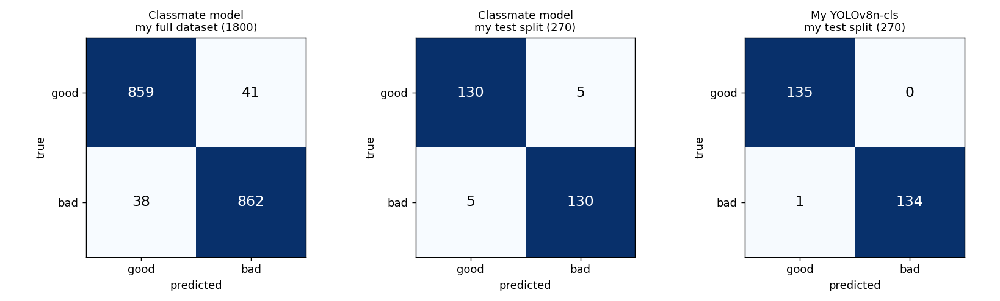
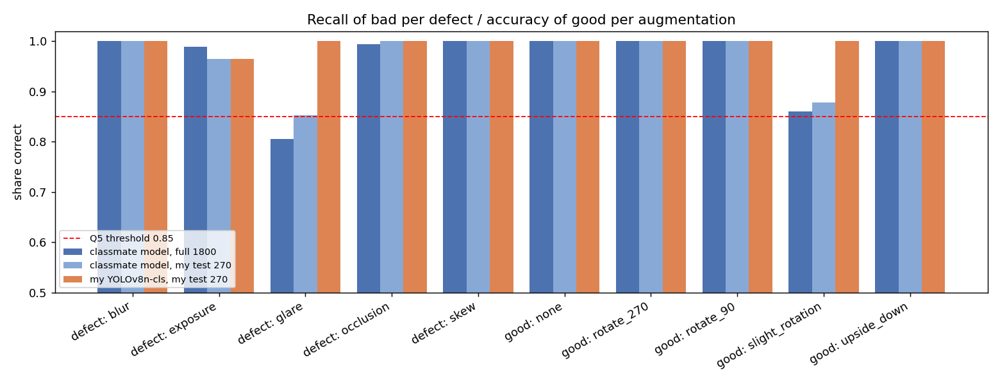
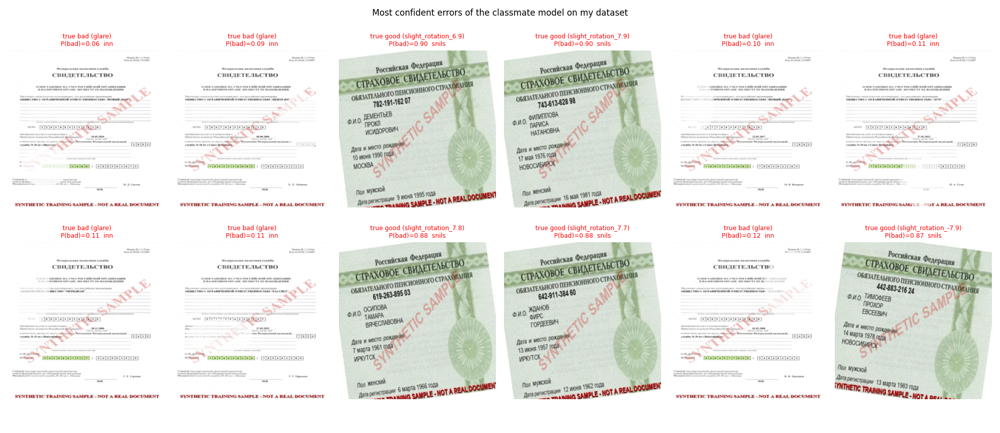

# Group Task — Cross-Testing a Classmate's Model on My Dataset

**Goal:** find out how a quality-gate model trained by a classmate on **their** synthetic data works on **my** data. I ran their model on my dataset without any retraining, then compared it with my own YOLOv8n-cls (Task 3) on the same images.

> **Result:** the classmate's YOLOv8n-cls reaches **0.956 accuracy / 0.956 F1(bad)** on my 1800 images, down from 0.993 validation accuracy on their own data. It passes 6 of 7 acceptance criteria from my Task 1 memo. It fails only Q5, because glare recall is 0.806 (< 0.85). Almost all errors fall into **two groups**: faint glare on the white INN form is missed, and SNILS cards rotated by more than ~6° are flagged as bad. On my 270-image test split it makes **10 errors**, while my YOLOv8n-cls makes **1**.

## 1. What I received

Folder [`yolov8n_quality_gate/`](yolov8n_quality_gate/) is the classmate's package, kept unchanged:

| File | Content |
|---|---|
| `yolov8n_quality_gate.pt` | Ultralytics YOLOv8n-cls checkpoint, classes `{0: 'bad', 1: 'good'}` (different weights from my model: other MD5) |
| `predict.py` | Classmate's prediction and evaluation script: CSV + accuracy, precision, recall, F1, confusion matrix |
| `README.md` | Their instructions: put images into `good/` and `bad/`, then run `python predict.py --source test` |

Training settings read from the checkpoint (`train_args`):

| Setting | Classmate's model | My YOLOv8n-cls (Task 3) |
|---|---|---|
| Base weights | `yolov8n-cls.pt` (ImageNet) | `yolov8n-cls.pt` (ImageNet) |
| Epochs / patience | 15 / 4 | up to 25 / 8 (stopped at 11) |
| Optimizer, lr0 | Adam, 1e-4 | AdamW, 1e-3 |
| Batch, image size | 16, 224 | 32, 224 |
| Dropout | 0.3 | 0 |
| Rotation augmentation | none (`degrees = 0`) | random 0/90/180/270° of both classes, built into the dataset |
| Colour / scale augmentation | hsv_s 0.7, hsv_v 0.4, scale 0.5 | hsv_s 0.2, hsv_v 0.15, scale 0 |
| Flips | off | off |
| Seed, hardware | 2473986, Colab GPU | 24500003, laptop CPU |
| Reported validation accuracy on own data | 0.993 | 0.993 (my validation split) |

## 2. Protocol

1. **Data:** my full dataset `5_practice/data/quality_dataset`, with 1800 images (INN, SNILS, passport), 900 good / 900 bad, laid out as `good/` and `bad/`. The classmate's model has never seen any of these images, so **all 1800 images are a fair external test set**.
2. **Run with the classmate's own script, unchanged** and exactly as their README says:
   ```
   python yolov8n_quality_gate/predict.py --source ../../5_practice/data/quality_dataset --out outputs/peer_predictions_full.csv
   ```
   Threshold: their default 0.5 on P(bad). Device: CPU. Terminal output: [`outputs/peer_predict_terminal_output.txt`](outputs/peer_predict_terminal_output.txt).
3. **Analysis:** [`analyze_peer_model.py`](analyze_peer_model.py) joins the predictions with my metadata (defect type, document type, good augmentation, rotation angle) and uses the same metric and latency code as Tasks 2–4 ([`common/quality_common.py`](../common/quality_common.py)). It also compares the classmate's model with my YOLOv8n-cls on **my 270-image test split**, where neither model has seen the images.
4. Positive class = **bad**, as in all my tasks.

## 3. Results

### 3.1 Overall

| Evaluation | Model | Accuracy | Precision (bad) | Recall (bad) | F1 (bad) | FN (missed bad) | FP (false alarms) |
|---|---|---|---|---|---|---|---|
| my full dataset, 1800 images | classmate's YOLOv8n-cls | 0.956 | 0.955 | 0.958 | 0.956 | 38 | 41 |
| my test split, 270 images | classmate's YOLOv8n-cls | 0.963 | 0.963 | 0.963 | 0.963 | 5 | 5 |
| my test split, 270 images | **my YOLOv8n-cls** | **0.996** | **1.000** | **0.993** | **0.996** | **1** | **0** |

The classmate's own script printed the same full-dataset numbers: accuracy 0.9561, F1(bad) 0.9562, confusion matrix `[[859, 41], [38, 862]]`.



### 3.2 Cost

The two models have the same architecture, so they have the same cost: **9.6 ms** per image on CPU (batch 1, 224×224, fp32, 10 warm-up + mean of 100 runs; my model: 9.5 ms), 1.44 M parameters, 5.6 MB fp32 state_dict (2.8 MB checkpoint file).

### 3.3 Acceptance criteria from my Task 1 memo (full dataset)

| Criterion | Value | Pass |
|---|---|---|
| Q1 accuracy ≥ 0.92 | 0.956 | ✅ |
| Q2 F1(bad) ≥ 0.92 | 0.956 | ✅ |
| Q3 recall(bad) ≥ 0.93 | 0.958 | ✅ |
| Q4 precision(bad) ≥ 0.88 | 0.955 | ✅ |
| Q5 recall ≥ 0.85 for every defect | glare **0.806** | ❌ |
| C1 CPU latency ≤ 50 ms | 9.6 ms | ✅ |
| C2 size ≤ 25 MB | 5.6 MB | ✅ |

### 3.4 Where the errors are

Recall of bad photos per defect and accuracy of good photos per augmentation:

| Group | Classmate, full 1800 | Classmate, my test 270 | Mine, my test 270 |
|---|---|---|---|
| bad: blur | 1.000 | 1.000 | 1.000 |
| bad: exposure | 0.989 | 0.964 | 0.964 |
| bad: **glare** | **0.806** | 0.852 | 1.000 |
| bad: occlusion | 0.994 | 1.000 | 1.000 |
| bad: skew | 1.000 | 1.000 | 1.000 |
| good: none | 1.000 | 1.000 | 1.000 |
| good: rotated 90 / 180 / 270° | 1.000 | 1.000 | 1.000 |
| good: **slight rotation ±3–8°** | **0.860** | 0.878 | 1.000 |



All 79 errors on the full dataset, by document and type:

| Document · type | Errors | Out of | Error rate |
|---|---|---|---|
| SNILS · good, slight rotation (false alarm) | 41 | 84 | 49 % |
| INN · glare (missed) | 28 | 60 | 47 % |
| SNILS · glare (missed) | 4 | 60 | 7 % |
| passport · glare (missed) | 3 | 60 | 5 % |
| SNILS · exposure (missed) | 2 | 60 | 3 % |
| SNILS · occlusion (missed) | 1 | 60 | 2 % |

False alarms on slightly rotated **good** images depend strongly on the angle and the document:

| Document | 3–5° | 5–6.5° | 6.5–8° |
|---|---|---|---|
| SNILS | 1 / 37 | 13 / 20 | **27 / 27** |
| INN | 0 / 43 | 0 / 31 | 0 / 31 |
| passport | 0 / 54 | 0 / 25 | 0 / 24 |



Full lists: [`outputs/peer_errors.csv`](outputs/peer_errors.csv) (all 79 errors, most confident first) and [`outputs/test_split_disagreements.csv`](outputs/test_split_disagreements.csv) (the 11 test images where at least one model is wrong).

### 3.5 Threshold check (diagnostic only)

| Threshold on P(bad) | 0.1 | 0.3 | 0.4 | **0.5** | 0.7 | 0.9 |
|---|---|---|---|---|---|---|
| Accuracy | 0.901 | 0.935 | 0.957 | **0.956** | 0.952 | 0.941 |
| FN / FP | 2 / 176 | 19 / 98 | 28 / 50 | **38 / 41** | 58 / 29 | 107 / 0 |

A different threshold does not fix the model. Lowering it catches the faint glare but adds even more false alarms, and raising it does the opposite. The errors are systematic, not a calibration problem. This sweep is chosen on the evaluation data itself, so it is a diagnostic only and not a reported result.

## 4. Interpretation

1. **The cross-dataset drop is moderate: −3.7 pp** (0.993 on their validation → 0.956 on my data). This is about the size of the 3–6 pp synthetic-to-real drop assumed in my Task 1 memo. Even two synthetic generators for the *same* documents differ enough to cost several points.
2. **Faint glare on the INN form is the main miss.** INN is a white form, and my glare is a semi-transparent white ellipse, so on INN it is almost invisible (see the gallery). The classmate's model gives these images P(bad) ≈ 0.06–0.47. My own analysis in Task 4 already named white-on-white glare as the weakest case. My model handles it because it was trained on exactly this kind of glare. The classmate's glare is probably stronger or more saturated, so their model learned "glare = clearly visible bright spot".
3. **Slight rotation of SNILS is read as "skew".** In my labelling, a sharp document tilted by ±3–8° is **good**, and skew starts at 15°. The classmate's model was trained without any rotation augmentation (`degrees = 0`). For SNILS, rotation creates visible white corners against the green card background, so any tilt above ~6° looks like a skewed photo to their model. INN and passport have light backgrounds, the corners are hardly visible, and there are no false alarms there. This is a **label-definition mismatch** at the good/skew boundary, not random noise.
4. **The rest is stable.** Blur, occlusion, strong skew, exposure and 90/180/270° rotations are recognised at 0.99–1.00. The core of the task transfers well between the two datasets.
5. **Comparison with my model:** on the same 270 test images my YOLOv8n-cls is better (1 error vs 10) at the same cost. This is expected because my test split comes from my own generator. A fair conclusion needs the reverse test: my model on the classmate's data.

## 5. Conclusions and recommendations

- The classmate's model is usable on my data (6/7 criteria, 0.956 accuracy). It is not production-ready for my definition of "bad" because glare recall is below 0.85.
- **For the classmate:** add slight rotations (±8°) of good images to training (e.g. `degrees = 8`), and add faint, low-contrast glare, especially on white forms.
- **For both of us:** agree on one written definition of the good/bad boundary, especially at what tilt angle "slight rotation" becomes "skew" and how strong glare must be to count as a defect. Most errors come from different definitions, not from a weak model.
- **For my generator:** INN glare with 47 % misses by an independent model shows that some of my glare samples are almost invisible. These samples are close to label noise and should be made stronger or relabelled.
- **Next step:** run my model ([`../release/yolov8n_quality_gate/`](../release/yolov8n_quality_gate/)) on the classmate's dataset to get the reverse result.

## 6. Files

| File | Content |
|---|---|
| [`yolov8n_quality_gate/`](yolov8n_quality_gate/) | classmate's model, script and instructions (unchanged) |
| [`analyze_peer_model.py`](analyze_peer_model.py) | analysis: metrics, breakdowns, comparison with my model, latency, charts |
| `outputs/peer_predictions_full.csv` | predictions of the classmate's script for all 1800 images |
| `outputs/peer_predict_terminal_output.txt` | terminal output of the classmate's script |
| `outputs/peer_evaluation.json` | all numbers in this report |
| `outputs/peer_errors.csv`, `outputs/test_split_disagreements.csv` | error lists |
| `outputs/confusion_matrices.png`, `outputs/per_defect_comparison.png`, `outputs/peer_failure_gallery.png` | figures |

**Reproduce** (from `6_practice/group_task/`, ≈ 1 min on CPU):
```
python yolov8n_quality_gate/predict.py --source ../../5_practice/data/quality_dataset --out outputs/peer_predictions_full.csv
python analyze_peer_model.py
```
