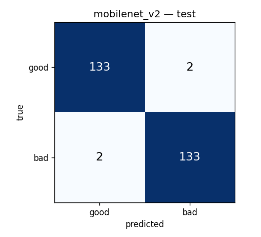
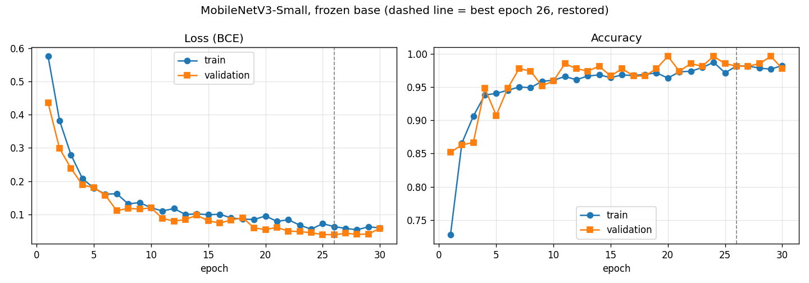
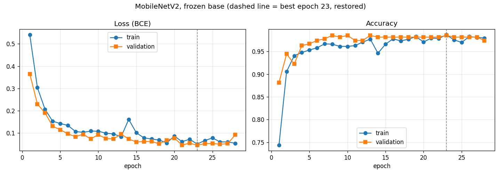

# Task 2 — MobileNet Baseline: Results and Comparison

**Notebook:** [`task2_mobilenet_baseline.ipynb`](task2_mobilenet_baseline.ipynb) (runs end-to-end, all outputs saved).
**Seed:** `24500003` (student ID) · **Positive class:** `bad` · **Decision threshold:** 0.5, fixed, not tuned.

## 1. What was done

Two ImageNet-pretrained backbones were trained as **frozen feature extractors** for the binary document-photo quality gate (good / bad). Both use exactly the same data, split, head, hyperparameters and evaluation:

- **MobileNetV3-Small** is the main model, the first of the three models selected in the Task 1 memo (MobileNetV3-Small, EfficientNet-B0, YOLOv8n-cls).
- **MobileNetV2** is the reference, because the course task names it as the baseline.

| Setting | Value |
|---|---|
| Dataset | `5_practice/data/quality_dataset`: 1800 synthetic images (INN, SNILS, passport), 900 good / 900 bad |
| Split | **70 / 15 / 15** by source document, stratified by document class: 1260 / 270 / 270 images, 0 source leakage ([`common/split_70_15_15.jsonl`](../common/split_70_15_15.jsonl)) |
| Input | RGB, resized 640 → 224×224, ImageNet mean/std normalisation |
| Backbone | ImageNet weights, all layers frozen, BatchNorm kept in eval mode |
| Head | Global average pooling → Linear(C, 128) → ReLU → Dropout(0.3) → Linear(128, 1) → sigmoid |
| Trainable parameters | 74 k (MobileNetV3-Small) / 164 k (MobileNetV2) |
| Training | Adam, lr 1e-3, batch 32, BCE loss, max 30 epochs, early stopping on validation loss (patience 5), best weights restored |
| Augmentation (train only) | random 0/90/180/270° rotation of **both** classes, which removes the "rotated = good" shortcut found in the Homework 3 audit |
| Hardware | Intel i7-10750H, CPU only (training and latency) |

The test split was used **once**, for the final evaluation. Early stopping used the validation split only.

## 2. Results on the test split (270 images)

| Model | Accuracy | Precision (bad) | Recall (bad) | F1 (bad) | F1 macro | CPU latency* | Size | Params | Train time | Best epoch |
|---|---|---|---|---|---|---|---|---|---|---|
| **MobileNetV3-Small** | 0.978 | **0.992** | 0.963 | 0.977 | 0.978 | **8.9 ± 1.1 ms** | **3.9 MB** | 1.0 M | **203 s** | 26 / 30 |
| MobileNetV2 | **0.985** | 0.985 | **0.985** | **0.985** | **0.985** | 17.6 ± 1.4 ms | 9.3 MB | 2.4 M | 983 s | 23 / 28 |

\* Batch 1, 224×224, fp32, 10 warm-up runs, then the mean of 100 runs (same protocol as the Task 1 benchmark).

### Confusion matrices

| MobileNetV3-Small | MobileNetV2 |
|---|---|
|  |  |
| 134 TN · **1 FP** · **5 FN** · 130 TP | 133 TN · 2 FP · 2 FN · 133 TP |

- FN = a bad photo predicted as good: it would be sent to OCR. This is the most expensive error.
- FP = a good photo predicted as bad: the user is asked to retake it.

### Detailed breakdown

| | MobileNetV3-Small | MobileNetV2 |
|---|---|---|
| Recall (bad), blur | 1.00 | 1.00 |
| Recall (bad), glare | 1.00 | 0.96 |
| Recall (bad), skew | 1.00 | 1.00 |
| Recall (bad), occlusion | **0.88** | 0.96 |
| Recall (bad), exposure | 0.93 | 1.00 |
| Accuracy (good), rotated 90/180/270° | 0.93 – 1.00 | 1.00 |
| Accuracy (good), slight rotation | 1.00 | 0.95 |
| Accuracy, INN / passport / SNILS | 0.99 / 0.96 / 0.99 | 0.98 / 0.98 / 1.00 |

## 3. Training curves and interpretation

**MobileNetV3-Small**

**MobileNetV2**

- **No overfitting.** Training and validation loss decrease together for ~25 epochs. Validation loss never turns upward while training loss keeps falling, which would be the overfitting signature.
- **Validation loss is below training loss.** This is expected, not an error: dropout and the random rotations are active only during training, so the training batches are harder than the clean validation images.
- **No underfitting.** Both models reach ~0.98 accuracy on train and validation. Frozen ImageNet features are already enough to separate blur, glare, skew, occlusion and exposure from clean documents.
- **Noisy validation accuracy.** Validation accuracy jumps by ±2–3 % between epochs because the validation set is small (1 image = 0.37 %). That is why the best epoch is chosen by validation **loss**, not accuracy.
- **Frozen-regime ceiling.** The curves flatten in the last epochs. Only the small head is trained, so further gains need fine-tuning of the last backbone blocks with a low learning rate (bonus experiment).

## 4. Comparison and conclusion

| Aspect | MobileNetV3-Small | MobileNetV2 | Winner |
|---|---|---|---|
| Accuracy / F1 | 0.978 / 0.977 | 0.985 / 0.985 | V2, by 2 images out of 270 (within test-set noise) |
| Recall (bad), i.e. missed bad photos | 0.963 (5 missed) | 0.985 (2 missed) | V2 |
| Precision (bad), i.e. unnecessary retakes | 0.992 (1) | 0.985 (2) | V3-Small |
| CPU latency | 8.9 ms | 17.6 ms | **V3-Small, 2× faster** |
| Model size | 3.9 MB | 9.3 MB | **V3-Small, 2.4× smaller** |
| Training time | 3.4 min | 16.4 min | **V3-Small, 5× faster** |

Why the models differ:
- MobileNetV3-Small has fewer, cheaper layers: hardswish activations, squeeze-and-excitation blocks, and a 576-channel output instead of 1280. This makes it faster and smaller.
- The richer 1280-dimensional MobileNetV2 features give the head a bit more information, which helps on partial defects such as occlusion.

### Acceptance criteria (fixed in the Task 1 memo before the experiments)

| Criterion | Threshold | MobileNetV3-Small | MobileNetV2 |
|---|---|---|---|
| Q1 Accuracy | ≥ 0.92 | ✅ 0.978 | ✅ 0.985 |
| Q2 F1 (bad) | ≥ 0.92 | ✅ 0.977 | ✅ 0.985 |
| Q3 Recall (bad) | ≥ 0.93 | ✅ 0.963 | ✅ 0.985 |
| Q4 Precision (bad) | ≥ 0.88 | ✅ 0.992 | ✅ 0.985 |
| Q5 Recall per defect | each ≥ 0.85 | ✅ min 0.88 (occlusion) | ✅ min 0.96 |
| C1 CPU latency | ≤ 50 ms | ✅ 8.9 ms | ✅ 17.6 ms |
| C2 Model size | ≤ 25 MB | ✅ 3.9 MB | ✅ 9.3 MB |

**Conclusion.**
- Both baselines pass every acceptance criterion.
- For the first gate of the Telegram bot, where every photo passes through the model, **MobileNetV3-Small is kept as the baseline**: it is 2× faster and 2.4× smaller, at the cost of ~0.7 pp accuracy (3 more missed bad photos out of 135).
- Its weak point is **occlusion (recall 0.88)**, close to the 0.85 limit. This will be tracked when comparing with YOLOv8n-cls and EfficientNet-B0.
- The results are on synthetic data. With the expected 3–6 % synthetic-to-real gap, ~0.98 here corresponds to roughly 0.92–0.95 on real phone photos, which is still above the real-world minimum stated in the memo.

## 5. Files

| File | Content |
|---|---|
| [`task2_mobilenet_baseline.ipynb`](task2_mobilenet_baseline.ipynb) | Full pipeline: split, data, model, training, evaluation, interpretation |
| `outputs/*_curves.png`, `outputs/*_history.csv` | Loss and accuracy curves per epoch |
| `outputs/*_confusion_matrix.png` | Confusion matrices on the test split |
| `outputs/test_metrics.json` | All metrics, breakdowns, acceptance checks and hyperparameters |
| `outputs/summary.csv` | Comparison table |
| `outputs/*_frozen.pt` | Trained weights (state_dict) |
| [`../experiment_log.csv`](../experiment_log.csv) | Experiment log shared by all Practice 6 tasks |
| [`../common/quality_common.py`](../common/quality_common.py) | Shared split, data loading, metrics, latency protocol and plots |

**Reproduce:** from `6_practice/task2`, run
`python -m nbconvert --to notebook --execute --inplace task2_mobilenet_baseline.ipynb`
(about 20 minutes on CPU).
