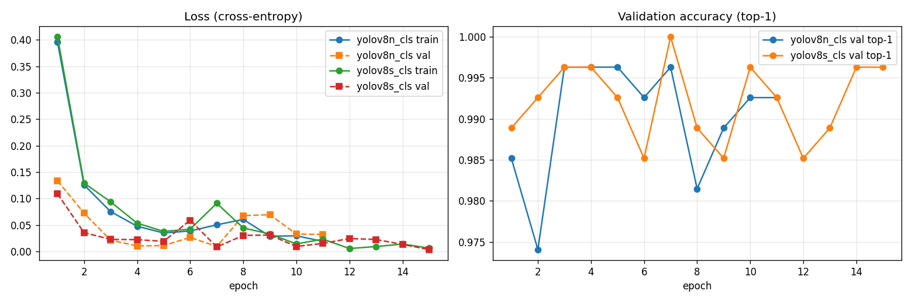
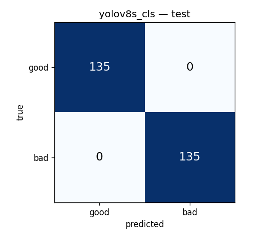

# Task 3 — YOLOv8 Classification: Results and Comparison with the Baseline

**Notebook:** [`task3_yolov8_classification.ipynb`](task3_yolov8_classification.ipynb) (runs end-to-end, all outputs saved).
**Seed:** `24500003` (student ID) · **Positive class:** `bad` · **Threshold:** 0.5 · **Ultralytics:** 8.4.189

## 1. What was done

Two Ultralytics YOLOv8 classification models were trained on **the same 70/15/15 split as Task 2** and evaluated with the same metric and latency code:

| Variant | Pretrained weights | Parameters (2-class head) | Regime |
|---|---|---|---|
| **YOLOv8n-cls** (nano) | ImageNet `yolov8n-cls.pt` | 1.44 M | full fine-tuning (all layers) |
| **YOLOv8s-cls** (small) | ImageNet `yolov8s-cls.pt` | 5.08 M | full fine-tuning (all layers) |

### Dataset structure

[`build_yolo_dataset.py`](build_yolo_dataset.py) reads the shared split [`../common/split_70_15_15.jsonl`](../common/split_70_15_15.jsonl) and writes the folder layout Ultralytics expects:

```
yolo_dataset/
├── train/ good/ 630  bad/ 630
├── val/   good/ 135  bad/ 135
└── test/  good/ 135  bad/ 135
```

The test images are **identical** to the Task 2 test images (same `source_id`s, no leakage).
- **Train:** each image gets a random 0/90/180/270° rotation (both classes, fixed seed). This is the same orientation augmentation as in Task 2; Ultralytics has no 90° rotation for classification.
- **Val and test:** copied unchanged.

The folder is not stored in git (213 MB); run the script to rebuild it.

### Hyperparameters (identical for both variants)

| Parameter | Value | Parameter | Value |
|---|---|---|---|
| imgsz | 224 | optimizer | AdamW, lr0 1e-3, linear decay to 1e-5, warm-up 3 epochs |
| epochs (max) | 25 | weight decay | 5e-4 |
| early stopping | patience 8 on val top-1 | batch | 32 |
| seed / deterministic | 24500003 / True | device | CPU (i7-10750H) |
| fliplr / flipud | **0 / 0**: mirrored text is unrealistic (guide rule) | erasing | **0**: random erasing would look like *occlusion* on GOOD images |
| auto_augment | **off**: RandAugment brightness/contrast changes look like *exposure* | hsv_s / hsv_v / scale | 0.2 / 0.15 / 0: mild colour jitter, no random crop |

The Ultralytics defaults were changed on purpose: with flips, random erasing and RandAugment, the training augmentation itself would create images that look like BAD defects but carry the GOOD label.

## 2. Training log



| | YOLOv8n-cls | YOLOv8s-cls |
|---|---|---|
| Epochs run (early stopping) | 11 | 15 |
| Best epoch (val top-1) | 3 (0.996) | 7 (1.000) |
| Training time (CPU) | 346 s (5.8 min) | 1034 s (17.2 min) |

How to read the Ultralytics output (`results.csv`):
- `train/loss` is the cross-entropy on augmented training batches; `val/loss` is the same on validation;
- `metrics/accuracy_top1` is validation accuracy;
- `top5` is always 1.0 because there are only 2 classes.

**Interpretation**
- **Very fast convergence.** Validation top-1 is ≥ 0.985 after the first epoch.
- **Mild overfitting after the best epoch.** Training loss keeps decreasing (nano: 0.048 → 0.019) while validation loss becomes noisy and partly rises (nano: 0.010 → 0.068 at epochs 8–9). This is the expected effect of training all parameters on 1260 images.
- **Not visible in the results.** Early stopping and `best.pt`, the best *validation* epoch, keep it out of the evaluated models. The test split was not used for this choice.

## 3. Results on the test split (270 images)

| Model | Accuracy | Precision (bad) | Recall (bad) | F1 (bad) | FN / FP | CPU latency* | Size fp32 | `best.pt` file | Params |
|---|---|---|---|---|---|---|---|---|---|
| **YOLOv8n-cls** | 0.996 | 1.000 | 0.993 | 0.996 | 1 / 0 | **10.1 ± 1.2 ms** | **5.6 MB** | 2.8 MB (fp16) | 1.44 M |
| YOLOv8s-cls | **1.000** | 1.000 | **1.000** | **1.000** | 0 / 0 | 17.7 ± 1.5 ms | 19.5 MB | 9.8 MB (fp16) | 5.08 M |

\* Batch 1, 224×224, fp32, CPU, 10 warm-up runs, then the mean of 100 runs: the same protocol as in Tasks 1 and 2.

| YOLOv8n-cls | YOLOv8s-cls |
|---|---|
|  |  |

- **The only error (YOLOv8n):** `bad_inn_exposure_265_v1`, an over-exposed INN form predicted as good with P(bad) = 0.39, close to the threshold. Over-exposure on the white INN form is weak; the Homework 3 audit flagged it as possible label noise.
- Recall per defect is 1.00 for all defects except exposure (0.96) for nano, and 1.00 everywhere for small.
- Every rotated GOOD image (90/180/270°) is classified correctly.
- All acceptance criteria from the Task 1 memo are passed by both variants.

## 4. Comparison with the Task 2 baseline (same test split)

| Model | Regime | Accuracy | Recall (bad) | F1 (bad) | Missed bad (FN) | False alarms (FP) | CPU latency | Size | Train time |
|---|---|---|---|---|---|---|---|---|---|
| MobileNetV3-Small (Task 2) | frozen base | 0.978 | 0.963 | 0.977 | 5 | 1 | **8.9 ms** | **3.9 MB** | 3.4 min |
| MobileNetV2 (Task 2) | frozen base | 0.985 | 0.985 | 0.985 | 2 | 2 | 17.6 ms | 9.3 MB | 16.4 min |
| **YOLOv8n-cls** | full fine-tune | **0.996** | **0.993** | **0.996** | **1** | **0** | 10.1 ms | 5.6 MB | 5.8 min |
| YOLOv8s-cls | full fine-tune | **1.000** | **1.000** | **1.000** | **0** | **0** | 17.7 ms | 19.5 MB | 17.2 min |

**Why the models differ**
1. **Training regime, the main reason.** YOLO fine-tunes *all* layers, so its convolution filters adapt to document-specific defects. The Task 2 MobileNets only trained a small head (74–164 k parameters) on frozen ImageNet features. The MobileNetV3-Small errors were occlusion and exposure: defects that generic ImageNet features capture worst.
2. **Architecture.** YOLOv8-cls is built from dense 3×3 convolutions in C2f/CSP blocks: more capacity per layer than depthwise-separable MobileNet blocks, and still CPU-friendly.
3. **Speed.** YOLOv8n has more FLOPs than MobileNetV3-Small but is only 1.2 ms slower. Dense convolutions use the CPU's vector units efficiently, while depthwise convolutions, squeeze-and-excitation and hardswish do not, so FLOPs alone do not predict CPU latency.
4. **Input size is not a factor.** All models use 224×224 inputs.

**Statistical caution.** One test image = 0.37 %. YOLOv8s (0 errors) and YOLOv8n (1 error) are statistically indistinguishable: by the "rule of three", 0/270 errors still allows a true error rate of up to ~1.1 %.

## 5. Conclusion

- **YOLOv8n-cls** gives the same practical quality as YOLOv8s-cls (1 error vs 0) at **1.75× lower latency and 3.5× smaller size**.
- Compared with the baseline, it makes **6× fewer errors** than MobileNetV3-Small for +1.2 ms.
- It is the strongest candidate for the bot's first gate so far.
- The fairness question (fine-tuned YOLO vs frozen MobileNet) is examined in Task 4 with a fine-tuned MobileNetV3-Small.

## 6. Files

| File | Content |
|---|---|
| [`task3_yolov8_classification.ipynb`](task3_yolov8_classification.ipynb) | Dataset build, training, evaluation, comparison, interpretation |
| [`build_yolo_dataset.py`](build_yolo_dataset.py) | Builds `yolo_dataset/` from the shared split |
| `outputs/test_metrics.json` | All test metrics, breakdowns, acceptance checks, hyperparameters |
| `outputs/comparison_with_task2.csv` | Comparison table with the Task 2 models |
| `outputs/*_test_predictions.csv` | P(bad) for every test image (used by Task 4) |
| `outputs/*_results.csv`, `outputs/yolo_curves.png` | Per-epoch training log and curves |
| `outputs/*_confusion_matrix.png` | Confusion matrices (own evaluation); `*_ultralytics_*.png` are Ultralytics validation plots |
| `runs/<variant>/` | Full Ultralytics run: `args.yaml`, `results.csv`, plots, `weights/best.pt` |

**Reproduce:** from `6_practice/task3`, run
`python -m nbconvert --to notebook --execute --inplace task3_yolov8_classification.ipynb`
(about 25 minutes on CPU; the pretrained weights are downloaded automatically).
