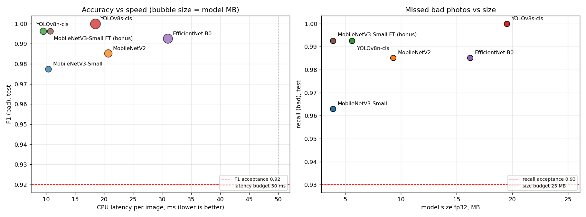

# Decision Memo — Model for the Document Photo Quality Gate

| | |
|---|---|
| Author | Vladislav Zherikhov |
| Date | 08.11.2026 |
| Decision | **Deploy YOLOv8n-cls as the first-gate quality model**; keep MobileNetV3-Small (fine-tuned) as the qualified fallback |
| Evidence | Tasks 2–4 of Practice 6: same 70/15/15 split, same test set (270 images), same metric and latency code, seed 24500003 |

## 1. Context

The Telegram bot receives phone photos of Russian documents (passport, INN, SNILS). Before any OCR, a binary model decides whether the photo is **good** (readable) or **bad** (blur, glare, skew, occlusion, bad exposure). A bad photo gets an instant "please retake" reply.

Deployment constraints (from the Task 1 memo):
- the gate runs on **every** request, so latency is added to every answer;
- it runs on a **CPU** server next to the OCR models, so it must be small;
- a **missed bad photo** (FN) is the costly error: wrong data comes out of OCR. A false alarm (FP) only costs a retake;
- the training data is **synthetic** (1800 images); a 3–6 % accuracy drop is expected on real photos.

## 2. Evidence

All results are on the same 270 test images, which were never used for training, model selection or threshold tuning. Latency: CPU i7-10750H, batch 1, 224×224, fp32, 10 warm-up runs, then the mean of 100 runs, all models measured in one session.

| Model | Regime | Accuracy | Recall (bad) | F1 (bad) | FN / FP | CPU latency | Size | Train time | All criteria |
|---|---|---|---|---|---|---|---|---|---|
| MobileNetV3-Small | frozen | 0.978 | 0.963 | 0.977 | 5 / 1 | 10.4 ms | 3.9 MB | 3.4 min | ✅ |
| MobileNetV2 | frozen | 0.985 | 0.985 | 0.985 | 2 / 2 | 20.7 ms | 9.3 MB | 16.4 min | ✅ |
| EfficientNet-B0 | frozen | 0.993 | 0.985 | 0.993 | 2 / 0 | 31.0 ms | 16.2 MB | 10.4 min | ✅ |
| **YOLOv8n-cls** | full fine-tune | **0.996** | **0.993** | **0.996** | **1 / 0** | **9.5 ms** | 5.6 MB | 5.8 min | ✅ |
| YOLOv8s-cls | full fine-tune | 1.000 | 1.000 | 1.000 | 0 / 0 | 18.5 ms | 19.5 MB | 17.2 min | ✅ |
| MobileNetV3-Small FT | frozen + last 3 blocks | **0.996** | **0.993** | **0.996** | **1 / 0** | 10.7 ms | **3.9 MB** | 5.9 min | ✅ |

## 3. Applying the pre-registered decision rule

The Task 1 memo fixed the rule **before** the experiments:

> A model is accepted if it passes Q1–Q5 and C1–C2. Among accepted models, the fastest wins; if the latency difference is below 5 ms, the one with the higher bad-class recall wins.

1. **Acceptance:** all 6 models pass every criterion.
2. **Speed:** the fastest group, within 5 ms of the fastest model, is YOLOv8n-cls (9.5 ms), MobileNetV3-Small (10.4 ms) and MobileNetV3-Small FT (10.7 ms).
   - YOLOv8s-cls (18.5 ms), MobileNetV2 (20.7 ms) and EfficientNet-B0 (31.0 ms) are 9–22 ms slower and drop out.
3. **Recall(bad) within the fastest group:** YOLOv8n-cls **0.993** = MobileNetV3-Small FT **0.993** > MobileNetV3-Small 0.963.
4. **Tie:** YOLOv8n-cls and MobileNetV3-Small FT have identical test metrics (1 FN, 0 FP). Their 1.2 ms latency difference is within the ±1 ms run-to-run variation. The rule does not separate them, so the final choice rests on deployment factors (section 4). This is stated openly: the tie-break was **not** pre-registered.

## 4. Why YOLOv8n-cls over MobileNetV3-Small FT

| Factor | YOLOv8n-cls | MobileNetV3-Small FT |
|---|---|---|
| Test quality | 1 FN, 0 FP | 1 FN, 0 FP (tie) |
| Latency | 9.5 ms (10.1 ms in Task 3) | 10.7 ms (8.9 ms frozen in Task 2) — tie |
| Size | 5.6 MB fp32 / 2.8 MB fp16 | **3.9 MB** fp32 |
| Training pipeline | **one stage**, one command, built-in early stopping and logging | two stages (frozen head → unfreeze, lower LR); more hand-written code |
| Export to the CPU server | **one command** to ONNX / OpenVINO / TFLite (`model.export(format="onnx")`) | manual `torch.onnx.export` |
| Occlusion (hardest defect) | recall 1.00 | recall 1.00 |
| Stage-2 synergy | same Ultralytics toolchain as a YOLO field detector (likely stage 2 of the pipeline) | separate code base |
| Licence | **AGPL-3.0** (Ultralytics), see risks | BSD-3 (torchvision) |

**Decision: YOLOv8n-cls.**
- At equal quality and speed, it gives the **simplest path to production**: one-stage training, reproducible with one command, and native export to ONNX/OpenVINO for a CPU server.
- It shares tooling with the likely YOLO-based document and field detection stage, so the bot needs one ML framework instead of two.
- The 1.7 MB size difference is irrelevant at server scale.

**Why not the most accurate model (YOLOv8s-cls, 270/270)?**
- Its advantage over YOLOv8n is **one test image**, which is not statistically meaningful: 0/270 errors still allows a true error rate of up to ~1.1 %.
- It costs 2× the latency and 3.5× the size.
- For a gate that runs on every photo, that price is not justified.

**Why not EfficientNet-B0?**
- It gives frozen-backbone quality (2 FN) at 3× the latency of YOLOv8n, with the largest latency variance (±7 ms).

## 5. Alternatives (ranked)

1. **MobileNetV3-Small FT**, the ready fallback: identical quality, smallest model, permissive BSD licence. Switch to it if the AGPL licence is not acceptable for the product.
2. **YOLOv8s-cls**, if real-photo validation shows that YOLOv8n's recall drops below the criteria and extra capacity helps. It still fits the latency (≤ 50 ms) and size (≤ 25 MB) budgets.
3. **EfficientNet-B0 with fine-tuning:** not tested. It is unlikely to win because its CPU latency is already 3× higher.

## 6. Risks and mitigations

| Risk | Impact | Mitigation |
|---|---|---|
| **Synthetic-to-real gap** larger than the expected 3–6 % | missed bad photos in production | Before launch, label 100–200 real phone photos and re-check the acceptance criteria. Add realistic augmentations (perspective, noise, JPEG, soft glare); the margin in the thresholds (0.92 vs real-world 0.86) covers a 6 % drop |
| **Test set is small** (270 images; 1 image = 0.37 %) | differences between the top models are not significant | Treat the top 3 models as equivalent in quality; confirm on a larger real test set |
| **Weak defects on white forms** (exposure/glare on INN) and **occlusion over empty areas** | label noise; borderline photos may pass | Make defect strength depend on the background, require occlusion to overlap text, and consider a lower threshold (e.g. 0.4) chosen on **validation** data to favour recall |
| **AGPL-3.0 licence** of Ultralytics | a closed-source commercial bot would have to publish its code or buy an Enterprise licence | Fine for the course and an open-source bot; otherwise switch to the MobileNetV3-Small FT fallback (BSD) at no quality cost |
| **Hardware change** (weaker server CPU) | latency grows | 9.5 ms leaves a 5× margin to the 50 ms budget; ONNX Runtime / OpenVINO export usually makes it faster still |
| **Data drift** (new document types, new phone cameras) | quality drops silently | Log gate decisions and user retakes; periodically label a sample of production photos |

## 7. Next steps

1. Export YOLOv8n-cls to ONNX and measure latency in ONNX Runtime on the target server.
2. Collect and label a small real-photo test set (own documents only) and re-run the evaluation; adjust the threshold on validation data if recall(bad) drops below 0.93.
3. Integrate the gate into the bot and return a retake hint per defect type (a future multi-class head).
4. Fix the dataset issues found in the error analysis (background-aware glare/exposure, occlusion over text) and retrain.
