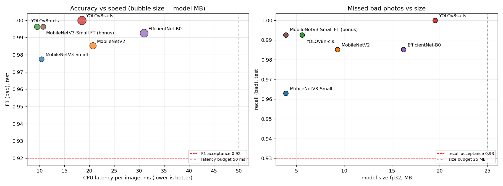
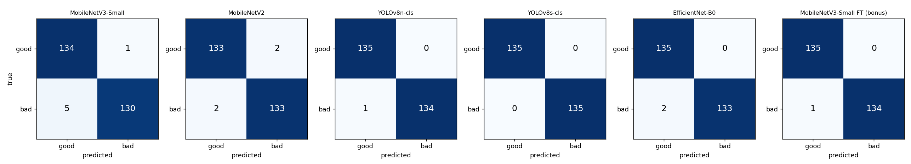
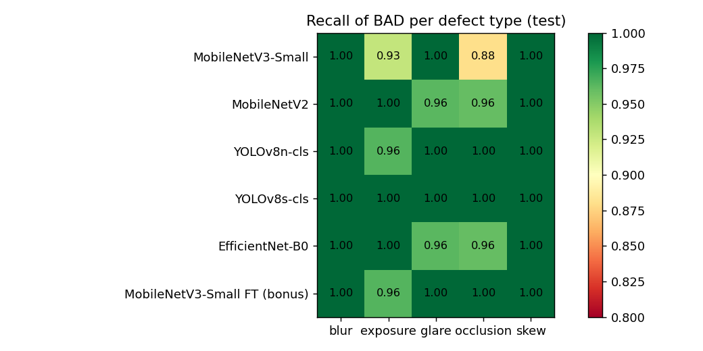
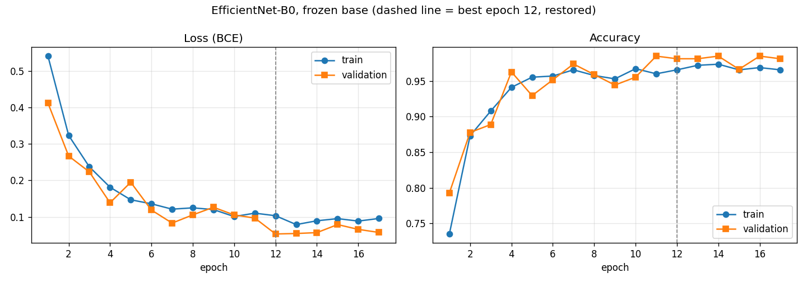
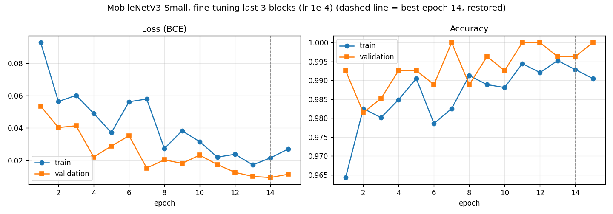
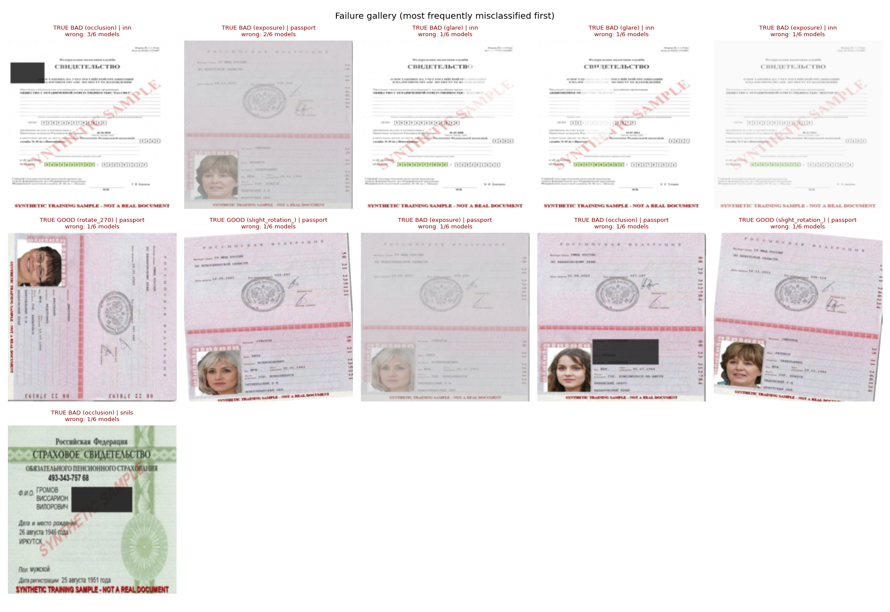

# Task 4 — Third Model, Full Comparison, Error Analysis

**Notebook:** [`task4_full_comparison.ipynb`](task4_full_comparison.ipynb) (runs end-to-end, all outputs saved)
**Decision memo:** [`DECISION_MEMO.md`](DECISION_MEMO.md) · **Presentation plan:** [`PRESENTATION.md`](PRESENTATION.md)
**Seed:** `24500003` · **Split:** the shared 70/15/15 split (1260 / 270 / 270) · **Positive class:** `bad` · **Threshold:** 0.5

## 1. What was done

1. **Third model: EfficientNet-B0**, the last of the three models selected in the Task 1 memo. It was trained with exactly the Task 2 protocol: frozen ImageNet backbone, the same head, Adam lr 1e-3, early stopping on validation loss, and random 90° rotations of both classes.
2. **Bonus: fine-tuning with a lowered learning rate.** MobileNetV3-Small starts from its Task 2 frozen checkpoint. The last 3 backbone blocks are unfrozen (72 % of weights) and trained with lr **1e-4** (10× lower).
3. **Full comparison** of all 6 trained models on the same 270 test images. Latency was re-measured for every model **in one session** (batch 1, 224×224, fp32, CPU, 10 warm-up + mean of 100 runs), so the numbers are directly comparable.
4. **Visualisations:** accuracy-vs-speed and recall-vs-size charts, confusion matrices side by side, and a recall-per-defect heatmap.
5. **Error analysis:** per-defect recall, the hardest defect, and a failure gallery.

**Family-appropriate preprocessing.** EfficientNet-B0's native input is 224×224 with ImageNet mean/std, the same as the MobileNets. The torchvision reference pipeline's resize-256 + center-crop-224 is **not** used: it would cut ~12 % off the page borders, where occlusion blocks, glare spots and skew corners often are. YOLO models use their own Ultralytics preprocessing (Task 3).

## 2. Full comparison table

| Model | Task | Regime | Accuracy | Precision (bad) | Recall (bad) | F1 (bad) | FN | FP | CPU latency | Size fp32 | Params | Train time |
|---|---|---|---|---|---|---|---|---|---|---|---|---|
| MobileNetV3-Small | 2 | frozen | 0.978 | 0.992 | 0.963 | 0.977 | 5 | 1 | 10.4 ms | 3.9 MB | 1.00 M | 3.4 min |
| MobileNetV2 | 2 | frozen | 0.985 | 0.985 | 0.985 | 0.985 | 2 | 2 | 20.7 ms | 9.3 MB | 2.39 M | 16.4 min |
| **EfficientNet-B0** | **4** | frozen | 0.993 | 1.000 | 0.985 | 0.993 | 2 | 0 | 31.0 ms | 16.2 MB | 4.17 M | 10.4 min |
| YOLOv8n-cls | 3 | full fine-tune | **0.996** | 1.000 | 0.993 | **0.996** | **1** | **0** | **9.5 ms** | 5.6 MB | 1.44 M | 5.8 min |
| YOLOv8s-cls | 3 | full fine-tune | **1.000** | 1.000 | **1.000** | **1.000** | **0** | **0** | 18.5 ms | 19.5 MB | 5.08 M | 17.2 min |
| **MobileNetV3-Small FT** (bonus) | **4** | frozen → last 3 blocks | **0.996** | 1.000 | 0.993 | **0.996** | **1** | **0** | 10.7 ms | **3.9 MB** | 1.00 M | 3.4 + 2.5 min |

All 6 models pass every acceptance criterion fixed in the Task 1 memo before the experiments: accuracy and F1 ≥ 0.92, recall(bad) ≥ 0.93, precision(bad) ≥ 0.88, every defect ≥ 0.85, latency ≤ 50 ms, size ≤ 25 MB.

Latency varies by about ±1 ms between sessions; for example, MobileNetV3-Small measured 8.9 ms in Task 2 and 10.4 ms here. Differences below ~2 ms should be treated as ties.

## 3. Visualisations

**Accuracy vs speed and recall vs size**

**Confusion matrices (test, rows = true, columns = predicted)**

**Recall of BAD per defect type**

## 4. Third model: EfficientNet-B0

- **Quality.** Best among the frozen models: 0.993 accuracy, 0 false alarms, 2 missed bad images (one glare, one occlusion). Its stronger ImageNet features (77.7 % top-1) transfer better than those of the MobileNets.
- **Cost.** The slowest and least stable model: 31.0 ± 7.0 ms. Squeeze-and-excitation blocks and SiLU activations are expensive on CPU, so its accuracy per millisecond is the worst of all models. It is 4× larger than MobileNetV3-Small.
- **Curves.** Train and validation loss decrease together, with validation accuracy jumping by ±2–3 % because of the small validation set. Best epoch 12; early stopping at 17. No overfitting.

## 5. Bonus: fine-tuning with a lowered learning rate

| | MobileNetV3-Small frozen (Task 2) | MobileNetV3-Small FT (Task 4) | Delta |
|---|---|---|---|
| Trainable weights | 74 k (7 %) | 719 k (72 %) | |
| Learning rate | 1e-3 (head) | 1e-4 (head + last 3 blocks) | 10× lower |
| Accuracy | 0.978 | **0.996** | **+1.85 pp** |
| Recall (bad) | 0.963 | **0.993** | **+3.0 pp** |
| F1 (bad) | 0.977 | **0.996** | +1.9 pp |
| Missed bad / false alarms | 5 / 1 | **1 / 0** | −4 / −1 |
| Occlusion recall | 0.88 | **1.00** | +0.12 |
| CPU latency / size | same | same | 0 |

- **Effect.** Fine-tuning closes the whole gap to YOLOv8n-cls.
- **Why.** The difference between YOLO and the Task 2 baseline came mostly from the **training regime**: frozen generic features vs features adapted to document defects. The architecture mattered much less.
- **Stability.** The low learning rate kept training stable: validation loss falls steadily to 0.009 with no forgetting.

## 6. Error analysis

### Hardest defect

| Defect | Mean recall over 6 models | Missed images (sum over models) |
|---|---|---|
| **occlusion** | **0.967** | **5** |
| exposure | 0.976 | 4 |
| glare | 0.988 | 2 |
| blur | 1.000 | 0 |
| skew | 1.000 | 0 |

**The hardest defect in our dataset is occlusion, not glare** as the guide expected:
- **Glare is mostly easy here.** Our glare is drawn as large white ellipses with 60–90 % opacity, which is very visible on colourful passports and SNILS. Both glare misses are on the **white INN form**, where white-on-white glare almost disappears. On real photos glare is softer and more varied, so it may become the hardest defect there.
- **Occlusion is hard when the block is small.** A small dark rectangle that partly covers an empty area changes very little in the image, and frozen ImageNet features do not treat "a dark block" as a defect.

### Failure gallery

Only **11 of 270** test images are misclassified by any model ([`outputs/failures.csv`](outputs/failures.csv)):
- **`bad_inn_occlusion_289_v1` (missed by 3 of 6 models).** The dark block sits in the empty top-left corner and barely hides any text, so the image is practically readable: **label noise**, not a model error. Only the frozen models miss it; both fine-tuned models catch it.
- **Exposure misses (4).** Washed-out or over-exposed pages that stay partly readable: the weak-exposure issue already found in the Homework 3 audit.
- **Glare misses (2).** Both on the white INN form.
- **False alarms (3).** Only frozen models (MobileNetV3-Small, MobileNetV2) on **rotated passports**. Fine-tuned models produce no false alarms.
- **Rotation shortcut.** No sign of it: no model fails systematically on rotated GOOD images.

**Data improvements suggested by the errors:**
- make the defect strength depend on the background (glare and exposure on white forms);
- require occlusion blocks to overlap text fields;
- add real phone photos to measure the synthetic-to-real gap.

## 7. Conclusion

- **Recommended model for the first gate: YOLOv8n-cls.** It is the fastest model (9.5 ms), with recall(bad) 0.993, 0 false alarms, 5.6 MB, 5.8 min of training, and one-command export.
- **Equal-quality alternative: MobileNetV3-Small FT** (3.9 MB, BSD licence).
- Full justification, alternatives and risks are in [`DECISION_MEMO.md`](DECISION_MEMO.md).

## 8. Files

| File | Content |
|---|---|
| [`task4_full_comparison.ipynb`](task4_full_comparison.ipynb) | EfficientNet-B0, fine-tuning bonus, comparison, charts, error analysis |
| `outputs/comparison_table.csv`, `outputs/comparison_results.json` | Full comparison table and all metrics, breakdowns, acceptance checks |
| `outputs/all_test_predictions.csv` | P(bad) of all 6 models for every test image |
| `outputs/accuracy_vs_speed.png`, `outputs/confusion_matrices.png`, `outputs/recall_per_defect.png` | Charts |
| `outputs/failure_gallery.png`, `outputs/failures.csv` | Failure gallery and list of misclassified images |
| `outputs/*_curves.png`, `outputs/*_history.csv` | Training curves of the new models |
| `outputs/efficientnet_b0_frozen.pt`, `outputs/mobilenet_v3_small_finetuned.pt` | Trained weights |

**Reproduce:** run Task 2 and Task 3 first (their weights and predictions are inputs), then from `6_practice/task4` run
`python -m nbconvert --to notebook --execute --inplace task4_full_comparison.ipynb`
(about 20 minutes on CPU).
