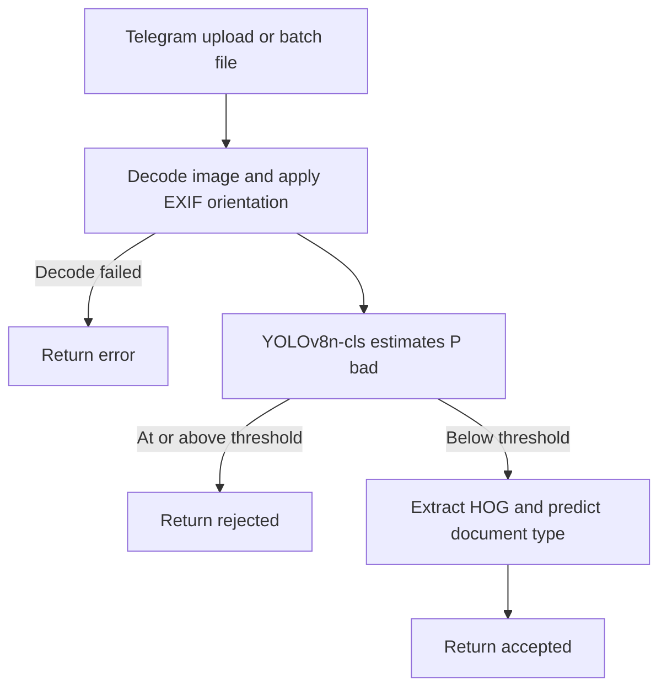

# Practice 7 — Document photo quality and type classification

[@project_zh_bot](https://t.me/project_zh_bot) accepts a document photo or file and returns a JSON decision. The service checks image quality first and identifies the document as an INN certificate, passport, or SNILS card only when the photo passes the quality check.

## 1. Reuse the quality model from Practice 6

Practice 6 compared models for the binary `good`/`bad` task. This project uses the selected YOLOv8n-cls checkpoint shipped in [models/yolov8n_quality_gate.pt](models/yolov8n_quality_gate.pt). It achieved 99.6% accuracy and 99.3% recall for bad images on 270 synthetic test images. Its mean CPU latency in the Practice 6 benchmark was 9.5 ms. See the [Practice 6 report](../6_practice/README.md) for the comparison and test protocol.

## 2. Train the document type classifier

1. [train_doctype.py](train_doctype.py) reads the [Practice 6 split manifest](../6_practice/common/split_70_15_15.jsonl) and opens the corresponding images from `5_practice/data/quality_dataset`.
2. It checks that each original document's `source_id` belongs to one split. This keeps augmented copies of a source image together throughout training and evaluation.
3. It selects images labeled `good` and uses their document type labels. The resulting dataset has 630 training, 135 validation, and 135 test images. The test split includes 45 images of each type.
4. [doctype.py](doctype.py) converts each image to grayscale and resizes it to 96 × 96. It computes Histogram of Oriented Gradients (HOG) descriptors at four right-angle orientations and averages the descriptors to handle rotated scans.
5. The training script fits logistic regression on the training split and evaluates it on each split. It exports the classifier to [models/doctype.joblib](models/doctype.joblib) and records per-class precision, recall, F1, confusion matrices, and test latency in [doctype_metrics.json](doctype_metrics.json).
6. The classifier identified all 135 held-out synthetic images correctly. The mean CPU time for reading an image, extracting its HOG features, and predicting its type was 4.324 ms. This evaluation covers the synthetic templates in the dataset. Accuracy on real photos has yet to be measured.

## 3. Combine the models into a pipeline



1. [pipeline.py](pipeline.py) reads [config.yaml](config.yaml) and loads both models once per pipeline instance. Model paths are resolved relative to the configuration file. The configuration also defines the model versions and stores the quality threshold.
2. Pillow decodes each upload, applies EXIF orientation, and converts it to RGB. The pipeline converts the array to BGR for the Ultralytics prediction call, which uses a 224-pixel input size on CPU.
3. The quality model estimates the probability of a bad photo. The default threshold is 0.5. A value at or above the threshold returns `rejected` with `poor_quality`, and the type model is skipped.
4. For an accepted photo, the classifier predicts `INN`, `PASSPORT`, or `SNILS` and returns the probability of its chosen class.
5. Corrupt images and other files that cannot be decoded return `error` with `unsupported_file`. Missing model files return `missing_model`. Inference errors return `inference_failed`.

### Response fields

| Field | Meaning |
| --- | --- |
| `file` | Original filename when available. Telegram photos use `telegram-photo.jpg`. |
| `status` | `accepted`, `rejected`, or `error`. |
| `quality` and `quality_confidence` | Quality decision and its probability when available. |
| `document_type` and `document_type_confidence` | Predicted type and probability for accepted images. Both fields are `null` after a quality rejection. |
| `reason` | Reason for rejection or error, or `null` on acceptance. |
| `model_versions` | Version identifiers for the quality and type models. |
| `latency_ms` | Pipeline processing time, including image decoding. Telegram download and reply time are outside this measurement. |
| `timestamp` | UTC timestamp in ISO 8601 format. |

## 4. Prepare samples and verify the pipeline

1. [prepare_samples.py](prepare_samples.py) selects held-out examples for all three document types, blur, and glare. It adds a deliberately corrupted JPEG and a text file with a JPEG filename. It also selects 20 held-out images for timing, split evenly between good and bad photos.
2. [tests/test_pipeline.py](tests/test_pipeline.py) checks the JSON schema, the three accepted types, and blur and glare rejection. It verifies that a rejected photo skips the type model. It also checks both invalid files, missing weights, a threshold change around the model's measured score, batch counts, and CPU latency.
3. The saved [pytest output](pytest_output.txt) shows 12 passing tests and a mean latency of 17.617 ms after warm-up on the 20 timing images. The assignment budget is below 500 ms per image on CPU.
4. [batch.py](batch.py) creates [predictions.json](predictions.json) from the seven demo files. The report contains three accepted images, two rejected images, and two file errors.

## 5. Reproduce the results

Use Python 3.13. From the repository root in PowerShell, install the pinned dependencies and run the tests and batch command.

```powershell
Set-Location "7 practice"
python -m pip install -r requirements.txt
python -m pytest -q -s
python batch.py
```

The two trained weight files are already in `models/`. To retrain the type classifier and regenerate the sample folders, run the following from `7 practice` with the full repository checked out.

```powershell
python train_doctype.py
python prepare_samples.py
python -m pytest -q -s
python batch.py
```

For a custom batch, pass a directory of files and an output path. The script processes the files directly inside that directory.

```powershell
python batch.py --source samples --output predictions.json
```

## 6. Run and deploy the Telegram bot

[bot_telegram.py](bot_telegram.py) registers `/start` and handles photo and file uploads. For a photo, it downloads the largest version supplied by Telegram. For a file, it uses the original filename when available. It passes the downloaded bytes to the same pipeline used by the batch command and returns the result as JSON. Uploads above 10 MiB and download failures receive structured error replies.

1. Create a bot through Telegram's `@BotFather` or use an existing bot's token.
2. Install the dependencies from [requirements.txt](requirements.txt) on a CPU host with Python 3.13 and network access to Telegram.
3. Store the token in the host's secret configuration as `TELEGRAM_BOT_TOKEN`.
4. Start one polling process with `python -u bot_telegram.py`. The terminal prints the bot username once the application connects.
5. Open the bot link from another Telegram account or device and send `/start`. For a laptop-hosted demo, keep the computer and polling process online throughout the demonstration.

For a local PowerShell session, enter the token without displaying it:

```powershell
$botSecret = Read-Host "Telegram bot token" -AsSecureString
$env:TELEGRAM_BOT_TOKEN = [System.Net.NetworkCredential]::new('', $botSecret).Password
try {
    python -u bot_telegram.py
} finally {
    Remove-Item Env:TELEGRAM_BOT_TOKEN
    Remove-Variable botSecret
}
```

## 7. Demonstrate the public service

1. Open [@project_zh_bot](https://t.me/project_zh_bot) and send `/start`.
2. Upload [good_inn.jpg](samples/good_inn.jpg) and show `accepted` with `document_type: INN`.
3. Upload [bad_blur.jpg](samples/bad_blur.jpg) as a file so Telegram preserves the example's original bytes. Show `rejected` and `document_type: null`.
4. Upload [renamed_text.jpg](samples/renamed_text.jpg) as a file. Show `error` and `reason: unsupported_file`.
5. Record 30 seconds of a live upload and reply for the submission.

The [saved live Telegram response](telegram_live_response.json) confirms that the public bot accepted the INN sample with 96.8% quality confidence and 99.0% type confidence. Its pipeline time for that single request was 214.675 ms. The warmed CPU benchmark reported above is an average across 20 local inputs.

The [model card](MODEL_CARD.md) describes the evaluation and limitations, including the synthetic-to-real gap. The [retrospective](RETROSPECTIVE.md) documents integration issues and proposed changes.
