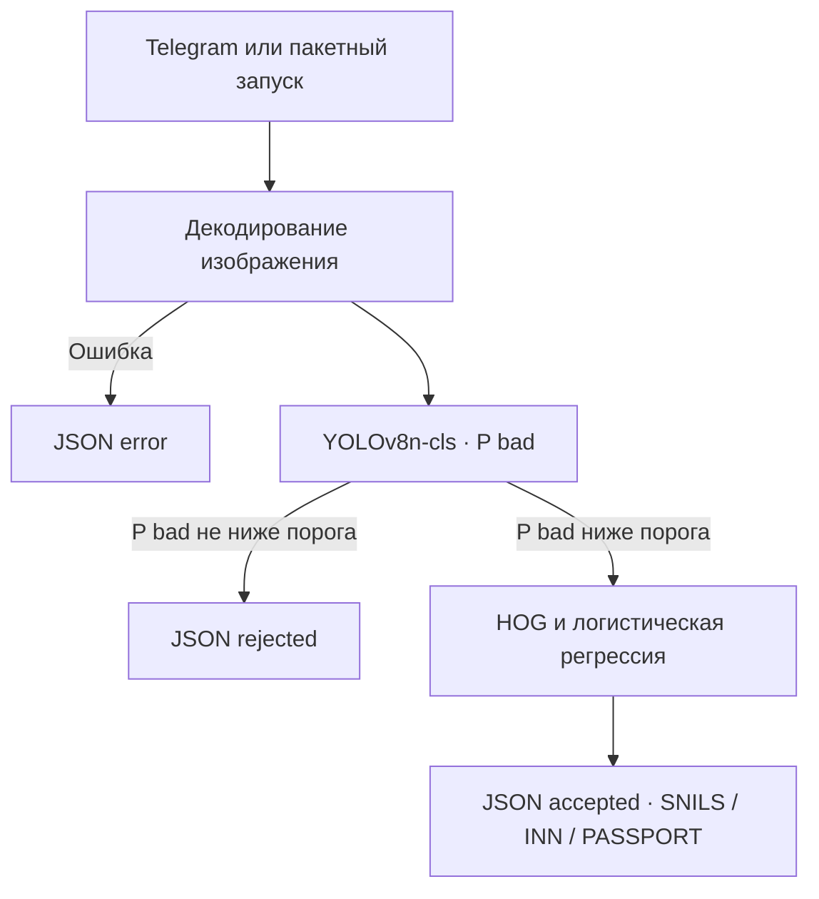

# Практика 7. Проверка качества и определение типа документа

Публичный интерфейс — [@project_zh_bot](https://t.me/project_zh_bot). Бот принимает фотографии и файлы, возвращает JSON с решением, уверенностью, версиями моделей и временем обработки. Для демонстрации используйте синтетические снимки из `samples/`.



## Локальная проверка

Из папки `7 practice` в Python 3.13:

```powershell
python -m pip install -r requirements.txt
python -m pytest -q -s
python batch.py
```

Веса обеих моделей находятся в `models/`. Порог `bad_threshold: 0.5` означает, что снимок отклоняется при `P(bad) >= 0.5`. Пути к весам отсчитываются от папки конфига. В ошибочных ответах недоступные значения имеют значение `null`. `latency_ms` включает чтение и декодирование файла и всю обработку внутри пайплайна. Время скачивания изображения через Telegram измеряется отдельно от пайплайна и в поле не входит.

Для переобучения модели типов из корня репозитория:

```powershell
python "7 practice/train_doctype.py"
python "7 practice/prepare_samples.py"
```

Скрипт обучения использует изображения практики 5 и разбиение по исходным снимкам из практики 6. Скрипт подготовки примеров берёт демонстрационные и измерительные файлы из тестового набора.

## Развёртывание бота

1. Создайте бота через `@BotFather` или используйте токен существующего бота. Передайте его процессу через `TELEGRAM_BOT_TOKEN`.
2. Для постоянно доступного экземпляра разверните папку практики как фоновый процесс на машине с Python 3.13, доступом к Telegram и CPU. Установка — `python -m pip install -r requirements.txt`, запуск — `python -u bot_telegram.py`. Добавьте токен в секреты площадки и оставьте ровно один экземпляр polling.
3. Для демонстрации с Windows можно поднять тот же polling-процесс на компьютере с доступом к интернету. Ссылка доступна участникам через Telegram, пока процесс запущен и компьютер онлайн.

```powershell
$botSecret = Read-Host "Telegram bot token" -AsSecureString
$env:TELEGRAM_BOT_TOKEN = [System.Net.NetworkCredential]::new('', $botSecret).Password
try { python -u bot_telegram.py } finally {
    Remove-Item Env:TELEGRAM_BOT_TOKEN
    Remove-Variable botSecret
}
```

Для демонстрации отправьте `good_inn.jpg`, `bad_blur.jpg` и `renamed_text.jpg` из `samples/` **как файлы**. Ждите соответственно `accepted` с типом INN, `rejected` и `error`. Отправка файла сохраняет дефекты без перекодирования Telegram.

## Материалы для сдачи

- [Пакетный прогон](predictions.json) — 3 accepted, 2 rejected, 2 error.
- [Вывод тестов](pytest_output.txt) — 12 тестов, средняя задержка 17,617 мс на CPU.
- [Карточка моделей](MODEL_CARD.md), [метрики классификатора типов](doctype_metrics.json) и [ретроспектива](RETROSPECTIVE.md).
- [Ответ на живой запрос в Telegram](telegram_live_response.json) — фото принято, распознан ИНН.
